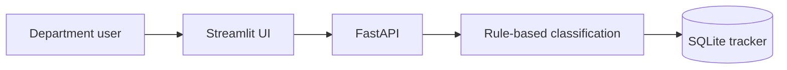

# Enterprise AI Operations Agent

**An enterprise-oriented portfolio project for operational request intake, workflow automation, and planned RAG-powered AI assistance.**

> **Portfolio focus:** Building an enterprise AI operations platform that connects departmental request intake, knowledge retrieval, workflow orchestration, and human-reviewed automation.

## Business problem

Operational departments such as HR, Finance, IT and Legal Operations receive repetitive policy questions and service requests. Requests arrive through different channels, are classified inconsistently and lack a central view of priority and status. This project explores how a controlled intake workflow can evolve into a governed AI-assisted operations platform.

## Implemented in Phase 1

- FastAPI endpoints for intake, request history and health checking
- Transparent rule-based classification and priority assignment
- SQLite-backed request tracker with a default `pending_review` state
- Streamlit request submission and tracking dashboard
- Unit tests for classification behavior

## Planned AI capabilities

1. **RAG knowledge assistant:** document ingestion, embeddings, vector search and citation-grounded answers using fictional HR/Finance/IT policies
2. **LangGraph orchestration:** classification, tool routing and explicit state transitions
3. **Human-in-the-loop workflows:** approvals before any sensitive action
4. **Operational evaluation:** retrieval accuracy, routing quality, approval enforcement and auditability

The roadmap is not a claim that these features are completed.

## Technology

| Implemented | Planned |
|---|---|
| Python, FastAPI, Pydantic, SQLite, Streamlit, pytest | LangGraph, LLM API, vector database, document embeddings, RAG, Docker |

## Architecture

See [architecture and roadmap](docs/architecture.md).



## Quick start

Requires Python 3.10+.

```bash
git clone https://github.com/AthulRaj016/enterprise-ai-operations-agent.git
cd enterprise-ai-operations-agent
python -m venv .venv
# Windows PowerShell: .venv\Scripts\Activate.ps1
# macOS/Linux: source .venv/bin/activate
pip install -r requirements.txt
uvicorn app.main:app --reload
```

In a second terminal (same virtual environment):

```bash
streamlit run dashboard/streamlit_app.py
```

API documentation: http://localhost:8000/docs

Example:

```bash
curl -X POST http://localhost:8000/requests \
  -H "Content-Type: application/json" \
  -d '{"department":"HR","description":"Where is the parental leave policy?"}'
```

Run tests:

```bash
python -m pytest -q
```

## Design notes and limitations

- Classification uses a small keyword list; it is not AI and must not be treated as authoritative.
- Authentication, authorization, durable audit trails and production-grade data protection are not yet implemented.
- The local dashboard is a development demonstration, **not production deployment**.
- No real client or employee records should be used.
- Outcomes and accuracy metrics will be reported only after evaluation.

## Roadmap

- [x] Create repository and project skeleton
- [x] Implement baseline intake API, tracker and rule-based routing
- [ ] Validate runtime behavior and add API integration tests
- [ ] Add synthetic knowledge documents and ingestion pipeline
- [ ] Implement vector search and cited RAG answers
- [ ] Integrate LangGraph agent state machine
- [ ] Implement explicit human approvals and protected actions
- [ ] Run evaluation suite and publish measured results
- [ ] Package with Docker and record demo

**Author:** [AthulRaj016](https://github.com/AthulRaj016)
