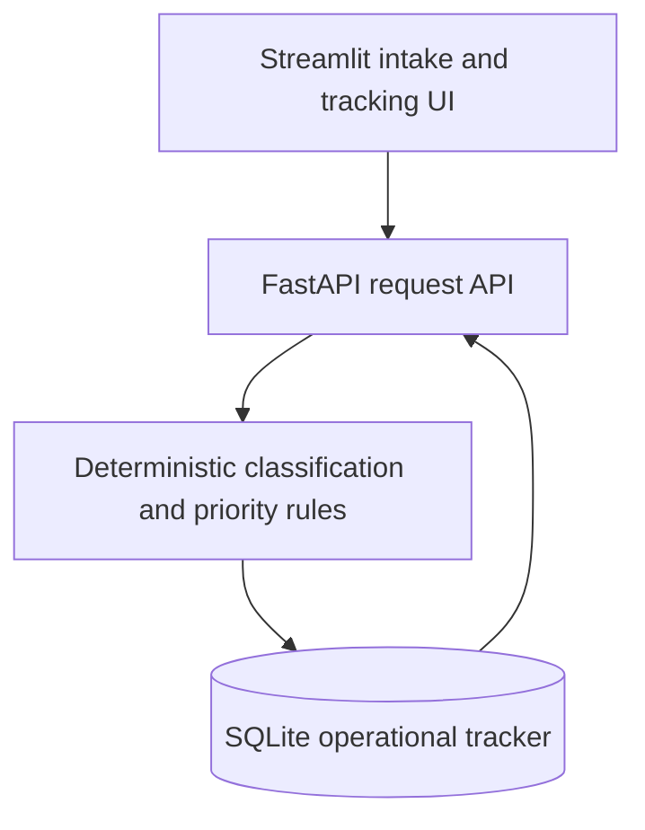
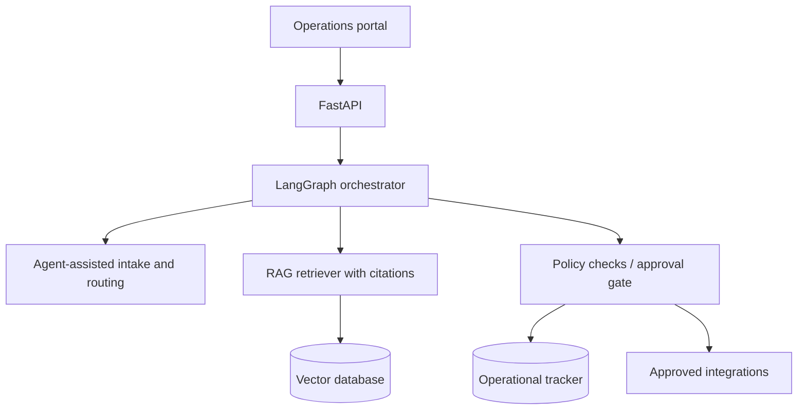

# Architecture and implementation status

## Phase 1: Request intake and tracking (MVP)

This phase is a **rule-based prototype, not an AI agent**. All incoming requests are placed in `pending_review` status. Classification does not authorize downstream actions.

## Planned agentic architecture

**Not yet implemented:** LangGraph routing, document embeddings, RAG, source citations, LLM-based responses, tool calling, authorization, production deployment, or approval execution.

## Safety and evaluation goals

- Use synthetic HR, Finance, and IT documents only.
- Require human approval for actions with financial, personnel, or access consequences.
- Preserve provenance for retrieved content and log workflow decisions.
- Evaluate classification agreement, citation validity, retrieval relevance, error handling, and approval enforcement.
